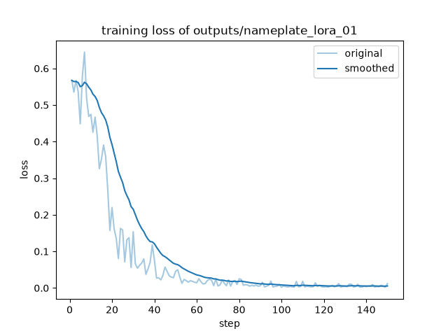
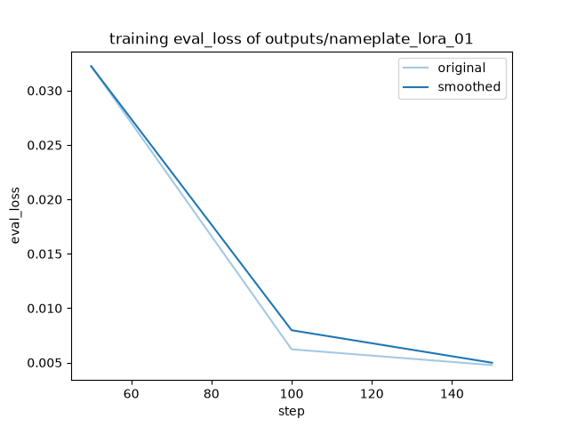

# LLaMA-Factory 多模态 LoRA SFT 实验记录

实验日期：2026-10-09 至 2026-10-10（Asia/Shanghai）。

任务：从设备铭牌图片中提取型号、电压和功率，按固定规则输出 JSON。基础模型为 Qwen2-VL-2B-Instruct，训练框架为 LLaMA-Factory，运行设备为 Apple M3 / 16 GiB。

本轮已完成数据构造、基线评估、LoRA SFT、独立测试、模型合并和重载检查。100 张合成测试图上的严格全对率为 97%；基础模型为 0%，仅去除回答外围代码围栏后为 20%。完整模型重载后，4 条固定样例的原始回答和终止原因均与 adapter 推理一致。

复现命令见 [复现说明](docs/REPRODUCING.md)，公开的指标和预测见 [results](results/README.md)。

## 1. 进度

|阶段|完成情况|主要结果|
|---|---|---|
|环境准备|完成|Python 3.11、PyTorch 2.8、BF16 / MPS 可训练|
|官方 demo 验证|完成|20 步训练；LoRA 参数更新、保存和重载成功|
|铭牌数据集|完成|600 张图片，train/val/test 为 400/100/100|
|数据与预处理检查|完成|图片可解码；划分无相同图片、型号组和模板 ID；序列长度 512–521 tokens|
|基础模型评估|完成|验证集诊断全对率 21%，测试集 20%；严格格式均不通过|
|铭牌 LoRA SFT|完成|3 轮、150 次参数更新，训练汇总耗时约 2 小时 19 分|
|生成评估|完成|验证集严格全对 99/100，测试集 97/100|
|错误分析|完成|两例空白补值，一例字段错配与漏提取|
|合并与重载|完成|BF16 完整权重约 4.42 GB；4 条样例输出一致|

## 2. 环境和版本

|组件|实测配置|
|---|---|
|硬件|Apple M3，10 核 GPU，16 GiB 统一内存|
|系统|macOS 14.3，ARM64|
|Python|3.11.17，uv 创建的独立环境|
|LLaMA-Factory|v0.9.5，提交 `7af909522a951e3ad9f022ea6f88b6755257eaa5`|
|PyTorch / torchvision / torchaudio|2.8.0 / 0.23.0 / 2.8.0|
|Transformers / Accelerate|4.57.6 / 1.11.0|
|PEFT / TRL|0.18.1 / 0.24.0|
|NumPy / Pillow|2.2.6 / 11.3.0|
|基础模型|`Qwen/Qwen2-VL-2B-Instruct`|
|模型 revision|`895c3a49bc3fa70a340399125c650a463535e71c`|

完整依赖见 [requirements.lock.txt](requirements.lock.txt)。框架源码未修改；基础模型使用原始 safetensors 权重，未量化。训练使用 BF16 混合精度，审计中同时存在 BF16 和 FP32 参数；生成推理与完整模型导出使用 BF16。

## 3. 环境准备中的问题

### 3.1 MPS 的混合精度支持受版本约束

首次使用 LLaMA-Factory v0.9.3、PyTorch 2.6.0、Transformers 4.51.3、Accelerate 1.7.0。MPS 可识别，但 FP16 测试报错：

```text
ValueError: fp16 mixed precision requires a GPU (not mps)
```

原因是该 Accelerate 版本的支持设备列表不含 MPS。升级到 LLaMA-Factory v0.9.5 和 Accelerate 1.11.0 后，又遇到：

```text
Grad Scaler with MPS device requires a Pytorch >= 2.8.0
```

随后将 torch、torchvision、torchaudio 成套升级到 2.8.0、0.23.0、2.8.0。基础线性层的 FP16 前向、反向和 AdamW 更新通过。

**阶段结论：MPS 可用不代表特定混合精度训练路径可用。需要检查框架、Accelerate 和 PyTorch 的实际组合。**

### 3.2 依赖检查通过后仍出现运行时错误

数据模块导入时报错 `pyarrow requires NumPy 2.0 or newer, found 1.26.4`。旧环境遗留的 NumPy 与新安装的 PyArrow 不兼容，而包元数据检查没有发现这一问题。

处理：固定 `numpy==2.2.6`，再次执行数据预处理和推理检查。升级期间另一次 torchvision 导入异常，在成套依赖安装完成并重启进程后消失。

### 3.3 小型 FP16 测试通过，完整图文模型仍失败

Qwen2-VL 的首次真实单步训练在图文 embedding 的 `masked_scatter` 处失败：

```text
RuntimeError: Unexpected floating ScalarType in at::autocast::prioritize
```

本机加载路径的基础权重实际为 BF16；设置 `infer_dtype=float16` 没有改变该版本训练加载器的权重类型。FP16 autocast 与 BF16 张量混用触发 MPS 类型错误。

处理：配置改为 `bf16: true`、`fp16: false`，先验证 BF16 基础更新，再执行完整模型单步训练。失败配置保留为 [train_mps_fp16_failed.yaml](configs/train_mps_fp16_failed.yaml)，错误日志见 [train_smoke_fp16_failure.log](results/logs/train_smoke_fp16_failure.log)。

**阶段结论：基础算子检查和完整模型检查不能互相替代。最终采用 BF16 / MPS，未修改框架训练逻辑。**

## 4. 官方 demo：验证训练和保存路径

v0.9.3 的相关数据 URL 返回 404，示例数据改从固定官方提交 `ce9dc9e072f80fa3abe0989d4ab90da25f083438` 获取。按图片分组：图 1、2 的中英文对话用于训练，共 4 条；图 3 的两条对话留出。相同图片的不同语言问答保持在同一集合。

配置为 LoRA rank 4、alpha 8、语言侧 q_proj/v_proj，冻结视觉塔和投影模块；像素上限 50,176，cutoff 512，batch size 1，训练 20 步。

|项目|结果|
|---|---:|
|可训练参数|544,768|
|发生变化的 LoRA 张量|112/112|
|训练耗时|30.1982 秒|
|训练汇总 loss|1.6046|
|原模型留出 loss|2.420160|
|训练后留出 loss|2.414332|

参数数值均有限。优化步骤结束时采样的最大 MPS 分配内存约 4.150 GiB，驱动分配约 7.174 GiB；这不是连续测量的进程峰值。

两张已见图片的回答没有变化，留出图片的描述发生变化。数据量过小，且没有第三份独立测试集，此阶段只确认训练、保存和加载可用。

### 4.1 CPU 与 MPS 合并的数值差异

首次在 CPU 上合并并导出 BF16 权重，模型能够加载，但部分回答与 MPS 上内存合并的 adapter 推理不同。固定随机种子和贪心解码后，差异仍然存在。

对 56 个 LoRA 目标矩阵进行检查：

- CPU 导出权重与 CPU 重建结果：0 个元素不同。
- CPU 导出权重与 MPS 重建结果：307,667 个元素不同。
- 最大绝对差：0.000244140625。

结果说明，导出并未丢失 adapter，不同设备的 BF16 合并数值差异可能影响后续生成。最终采用 `export_device: auto`，在本机使用与 adapter 推理相同的 MPS 合并路径。三个固定样例重载后逐字一致。

诊断记录见 [merge_precision.json](results/demo/merge_precision.json) 和 [reload_comparison.json](results/demo/reload_comparison.json)。CPU 对照权重保留在本地，未随仓库发布。

## 5. 铭牌数据集

### 5.1 任务规则和生成方式

使用 Pillow 生成 600 张 672×448 的设备铭牌，随机种子为 20261009。图片和答案来自同一份明确的绘图规格，没有调用模型生成标签。

提取规则：型号按图抄录；电压保留数字和 V，去除 AC/DC 与空格；功率保留数字和 W；字段未出现、空白或标为 `--`、`N/A` 时输出 JSON `null`。禁止根据其他字段补值。

每个集合中 70% 的样本字段完整，型号、电压、功率各有 10% 的样本缺失。训练使用 T01–T08，验证使用 V01–V02，测试使用 E01–E02。型号组和模板 ID 不跨集合重复。字体、绘图组件及字段语义仍然共享。

首次生成时，字体左侧 bearing 导致绘制边界断言失败。按文本实际包围盒修正绘制坐标后，重新生成完成。字体路径、哈希、绘图文本和坐标保存在生成记录中。字体文件本身未随仓库分发。

### 5.2 数据检查

|检查项|结果|
|---|---|
|记录数量|400 / 100 / 100|
|图片引用与解码|600 条引用全部可读取|
|答案结构|全部可解析为 JSON，三个固定字段，值为非空字符串或 null|
|图片文件 SHA-256 跨集合交集|三组均为 0|
|型号组跨集合交集|三组均为 0|
|模板 ID 跨集合交集|三组均为 0|

首条训练样例为 SV-230、AC 110 V、功率 `--`，对应标签 `{"型号":"SV-230","电压":"110V","功率":null}`，图文一致。另对字段完整、空白和未出现的情况进行了人工抽查；未保留每张抽查图的独立转录，也未逐张人工审核全部 600 张图片。

数据结构中的 `assistant.content` 是包含 JSON 文本的字符串；内部 JSON 的 `null` 与字符串 `"null"` 不同。文件哈希检查只能识别字节完全相同的图片，型号与模板检查也不能证明不存在全部形式的视觉相似。

发布整理时增加了 [verify_repository.py](scripts/verify_repository.py)，将数据结构、图片哈希、跨集合分组和已保存预测的复核整理为可重复执行的检查。

## 6. 基线与评分规则

固定模型模板 `qwen2_vl`，BF16、关闭采样、随机种子 42、`max_new_tokens=128`，图片像素上限为 301,056。标准答案只参与评分，不输入模型。

第一条验证样例的三个字段均正确，但回答带有 Markdown 代码围栏。换行和缩进属于合法 JSON 空白；代码围栏不属于 JSON。因此将原始输出合规性与去围栏后的诊断结果分开记录。

|指标|定义|
|---|---|
|原始 JSON 对象率|整段回答可解析为对象；拒绝重复键和 NaN/Infinity|
|严格格式合规率|原始 JSON 恰好包含三个字段，值类型和整数 V/W 格式符合规则|
|严格全对率|严格格式通过，三个字段全部等于标准答案|
|诊断全对率、字段正确率|只移除包住整段回答的一层代码围栏，再按原值比较|
|缺失字段正确率|仅在标准答案为 null 的字段中计分；漏键不等于 null|

诊断过程不修正单位、不替换字符串 null，也不从解释文字中截取 JSON。无法解析的样本仍进入分母。

验证集基线：100 条回答均带代码围栏，严格格式和严格全对率均为 0%；诊断全对率 21%，型号、电压、功率正确率分别为 90%、36%、40%，缺失字段仅 1/30 正确。没有回答因达到生成上限而结束。

典型错误：AB-285 的 `12 V` 未规范化为 `12V`；ZK-978 的 `230 V`、`1200 W` 均保留空格；RT-157 的功率输出字符串 `"null"`。

**阶段结论：问题包含输出格式、单位规范化和缺失值类型。仅去除围栏不足以完成任务；字段错误率也不能直接解释为数字 OCR 错误率。**

## 7. 铭牌 LoRA 训练

配置见 [train_nameplates_mps.yaml](configs/train_nameplates_mps.yaml)。

|参数|设置|
|---|---|
|LoRA|rank 4，alpha 8，dropout 0，q_proj/v_proj|
|冻结模块|视觉编码器、多模态投影模块|
|序列与图片|cutoff 1024，image_max_pixels 301056|
|精度|BF16 混合精度|
|batch / 梯度累积|1 / 8|
|训练计划|3 轮，max_steps=-1，150 次优化器更新|
|学习率|1e-4，warmup 10 步，余弦调度|
|验证与保存|每 50 步|
|其他|梯度检查点，AdamW，max_grad_norm=1.0，seed=42|

`max_steps` 为正时会优先限制训练步数，因此没有沿用 demo 的 20 步设置。正式训练从基础模型新建 LoRA，没有接着单步试训的 adapter 继续训练。

### 7.1 原生图文预处理

使用 LLaMA-Factory 原生数据处理路径检查 400 条训练和 100 条验证数据。序列长度均在 512–521 tokens，低于 cutoff 1024；没有空监督标签，也没有 labels/input_ids 长度不一致。

`labels=-100` 的位置不计入 SFT 损失。该检查核验长度与监督范围，并预览首条监督答案，未逐条比对解码答案和源标签的全部内容。

重复执行时遇到“报告已存在”。检查已有 JSON 完整、配置一致、明细数量正确后直接复用报告，没有覆盖或重跑。报告见 [nameplate_token_validation_01.json](results/checks/nameplate_token_validation_01.json)。

### 7.2 单步试训

处理 8 条训练样本，完成 1 次优化器更新，epoch=0.02，loss=0.5673，耗时约 36.48 秒。56 个 LoRA 张量发生变化，最大绝对变化约 1e-4，全部 adapter 数值有限。

LoRA 默认 B 矩阵初始化为零，第一步不要求所有 A/B 张量都发生变化。该检查确认参数更新发生，尚不能说明生成准确率提高。

### 7.3 三轮训练

前七步 loss 在 0.4488–0.6447 间波动。不同步骤对应不同样本，不能单凭局部上升判断训练失败。学习率从 0 开始预热，随后余弦下降。

日志中的 `grad_norm` 一度高于 1.0。核对本机 Trainer、Accelerate 和 PyTorch 路径后，确认日志记录的是裁剪前总梯度范数，并不表示 `max_grad_norm=1.0` 失效。

第一轮第 50 步附近的训练日志 loss 为 0.0456；它不是整轮平均值。

|轮次|更新步数|验证 loss|
|---|---:|---:|
|1|50|0.03224264|
|2|100|0.00621725|
|3|150|0.00476644|

完整训练汇总 loss=0.07990990，训练器报告耗时 8372.4511 秒。该耗时包含训练期间验证等开销，不能当作纯训练计算耗时。

审计确认 544,768 个参数可训练，全部属于语言侧 LoRA；112/112 个张量发生变化，最大绝对变化 0.00800647，所有 adapter 数值有限。最终 adapter 权重为 2,195,400 字节。

**阶段结论：训练与参数保存完成，验证损失逐轮下降。生成格式和字段正确率仍需由固定协议的生成评估确认。**





## 8. 验证集与独立测试

验证集微调后严格格式 100%，严格全对 99/100，型号、电压、功率正确率分别为 100%、99%、100%；缺失字段正确 29/30。

剩余验证错误位于第 97 条：DK-123 的电压空白，标准答案为 null，模型填成 220V，功率 200W 正确。这是空白信息被补成数值，与基线的字符串 null 类型错误不同。

之后固定 adapter、提示、评分规则和推理设置，进行独立测试。基线和 LoRA 的数据、评分脚本哈希与随机种子相同，配置差异仅为是否加载 adapter。测试前后的 adapter 权重哈希一致。

|测试集指标（100 条）|基础模型|LoRA|
|---|---:|---:|
|严格格式合规率|0%|100%|
|严格全对率|0%|97%|
|仅去围栏后的诊断全对率|20%|97%|
|型号正确率|90%|100%|
|电压正确率|27%|97%|
|功率正确率|41%|99%|
|缺失字段正确数|0/30|28/30|
|达到生成上限的回答|0|0|

严格全对率的提升同时包含格式遵循与字段提取的变化，不能将其全部归因于 OCR 能力提升。验证集 99/100 与测试集 97/100 相差两条，单凭这一差异不足以判断明显过拟合。

### 8.1 测试失败案例

|序号|型号|图片内容与标准答案|模型回答|判断|
|---|---|---|---|---|
|12|CX-236|电压空白，功率 200W|电压 220V，功率 200W|空白补值|
|17|KR-517|电压空白，功率 1000W|电压 220V，功率 1000W|空白补值|
|19|QS-566|电压 AC 380 V，功率 1800W|电压 1800V，功率 null|字段错配与漏提取|

三张原图均已核对。第 19 条的 1800 对应功率，380 对应电压，不能归类为“应为 1800V 却识别成 380V”的数字识别错误。三个失败样本合计四个错误字段。

缺失值指标只统计标准答案为 null 的位置，所以第 19 条功率被错误置 null 计入功率正确率，不计入 28/30 的分母。

错误图片：[第 12 条](data/nameplates_v1/images/159636b8d0974227.png)、[第 17 条](data/nameplates_v1/images/31a74177607e6d3e.png)、[第 19 条](data/nameplates_v1/images/6b5c69babf72f730.png)。本轮未根据这些测试错误继续调参。

## 9. 完整模型导出与重载

2026-10-10 合并 `outputs/nameplate_lora_01`，配置见 [export_nameplates.yaml](configs/export_nameplates.yaml)。沿用 BF16 和 `export_device: auto`，保持本机 MPS 合并路径。完整模型包含 2,208,985,600 个参数。

导出日志中的 `custom_generate/generate.py` 未找到信息和 `torch_dtype` 弃用警告没有阻止导出，后续重载检查通过。没有因此更换依赖版本。

|分片|张量数|权重数据字节数|
|---|---:|---:|
|1|423|1,995,495,424|
|2|253|1,993,033,728|
|3|53|429,442,048|

共 4,417,971,200 字节权重数据，与索引的 total_size 一致。每片索引、safetensors 文件头和数据区长度核对通过。tokenizer、processor、聊天模板及基础模型 LICENSE 一并保存。生成了 Modelfile，但未测试 Ollama。

独立重载时只加载完整模型，不再指定 adapter。沿用同一图像处理和生成设置，对比以下固定样例：

|测试序号|类型|原始回答一致|终止原因一致|
|---|---|---|---|
|1|字段完整，回答正确|是|是|
|3|存在缺失字段，回答正确|是|是|
|12|已知空白补值错误|是|是|
|19|已知字段错配错误|是|是|

包括已知错误在内的四条输出均一致，说明这些输入上的行为在导出后得到保留。报告见 [nameplate_reload_check_01.json](results/checks/nameplate_reload_check_01.json)。该阶段尚未重新运行完整 100 条测试；后续追加审计完成了全量对照，见第 11 节。

## 10. 当前结论和未验证范围

在本机 M3 / 16 GiB、BF16、冻结视觉模块、batch size 1 和当前分辨率下，Qwen2-VL-2B 的多模态 LoRA SFT 已完成。本任务的直接 JSON 输出、单位格式和缺失值处理明显改善，仍存在空白补值和字段错配。

数据全部为合成图，训练、验证和测试共享字体与绘图组件。结果不能代表真实照片中的反光、模糊、透视或复杂设备布局。没有验证其他硬件、量化部署、Ollama 或服务化部署。本轮未开展 verl 的强化学习后训练。

公开仓库保存数据、脚本、配置、最终 adapter、评估预测及关键日志。原始本地记录和大型模型保留在本机；公开报告中的个人绝对路径已替换，原始与发布副本的哈希对应关系见 [publication_manifest.json](results/publication_manifest.json)。

## 11. v2 数据扩充对照与追加审计

2026-10-10 完成追加诊断、原 v1 checkpoint 对比、完整导出模型全量对照，以及普通/困难数据扩充实验。v1 历史评分与原始预测保持不变。

- 原 v1 的第 50、100、150 步在旧验证集上的严格全对分别为 85/100、97/100、99/100，缺失字段正确分别为 15/30、27/30、29/30；第 150 步复用与发布 adapter 权重哈希一致的原评估。
- 合并模型重新推理全部 100 条旧测试样本，原始回答、终止原因、评分均与 adapter 推理一致，严格全对仍为 97/100。
- v2 生成 1,200 张新图片。两组训练各 800 条（原训练 400 条加扩充 400 条），新验证与测试各 200 条、50 个父组；父组、型号、模板与图片哈希的集合边界由独立检查核对。
- 两组均从相同基础模型训练，seed=42、150 次更新；每 50 步单独生成验证，按事先固定的规则选择，两组均选中第 150 步。最终测试开始前固定了所选权重指纹。

|同一 v2 测试集上的模型|严格全对|缺失字段正确|有值字段误置空|
|---|---:|---:|---:|
|原 v1 adapter|191/200|141/150|0/450|
|普通扩充|193/200|143/150|0/450|
|困难扩充|198/200|148/150|0/450|

困难组比普通组提高 2.5 个百分点，父组配对 bootstrap 的 95% 区间为 [+0.5, +5.0] 个百分点。两组在旧验证集上均为 99/100。该结果支持完整困难数据配方在本批合成铭牌上的效果，不能分别估计缺失比例和成对构造的贡献，也不涵盖不同训练种子或真实照片。

实验队列于北京时间 19:24 完成，随后复算指标、核对选择顺序和权重指纹并完成归档。完整结果见 [v2 报告](results/v2_experiment_01/REPORT.md)，两个所选 adapter 位于 [artifacts/nameplate_v2_01](artifacts/nameplate_v2_01)。归档副本由独立 [v2 publication manifest](results/v2_experiment_01/publication_manifest.json) 记录来源与哈希。
