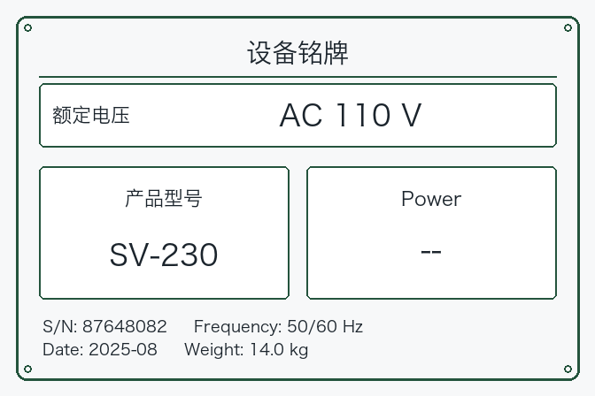

# Multimodal LoRA Lab

在 Apple M3 / 16 GiB 上，使用 LLaMA-Factory 对 Qwen2-VL-2B-Instruct 进行多模态 LoRA SFT。任务是从设备铭牌图片中提取型号、电压和功率，直接输出 JSON。

本仓库包含实验数据、训练配置、评估脚本、最终 LoRA adapter 和过程记录。实验完成于 2026-10-10。

## 任务示例



标准答案：

```json
{"型号":"SV-230","电压":"110V","功率":null}
```

型号按图抄录；电压去除 AC/DC 和空格；功率去除空格。字段未出现、空白或标为 `--`、`N/A` 时输出真正的 JSON `null`。

## v1 实验结果

600 张合成图片按训练 400、验证 100、测试 100 划分。型号组、模板 ID 和字节相同的图片不跨集合重复。LoRA 训练 3 轮、150 次优化器更新，训练器报告耗时约 2 小时 19 分。

|独立测试集（100 张）|基础模型|LoRA|
|---|---:|---:|
|严格格式合规率|0%|100%|
|严格全对率|0%|97%|
|仅去掉外围代码围栏后的全对率|20%|97%|
|型号正确率|90%|100%|
|电压正确率|27%|97%|
|功率正确率|41%|99%|
|缺失字段正确数|0/30|28/30|

严格全对要求原始回答符合 JSON 与字段规则，并且三个值全部正确。诊断计分只去除整段外围的代码围栏，不修正单位、字段值或 null 类型。

验证集严格全对率为 99/100。完整模型合并导出后，已追加完成 [100 条全量对照](results/v2_merged_v1_test_01/comparison.json)：原始回答、终止原因和评分均与 adapter 推理一致，严格全对率仍为 97/100。

### 追加诊断：规则后处理基线

基于已保存的原始预测，新增 [分析脚本](scripts/analyze_nameplate_predictions.py) 和 [测试集报告](results/analysis_v2/test.json)。这次分析没有重新训练或推理，也没有修改上面的严格评分。

固定规则为：仅去外围代码围栏；把字符串 `null`、`--`、`N/A`、空串转换为 JSON null；去除电压和功率中的空白，以及电压中的 AC/DC。型号除明确的缺失标记外原样保留。不修正数字、不补单位、不补漏键、不删除额外键。

|测试集规则处理后全对|基础模型|LoRA|
|---|---:|---:|
|全部样本|76/100|97/100|
|字段完整|68/70|69/70|
|存在缺失字段|8/30|28/30|

LoRA 的 null precision 为 28/29，recall 为 28/30；两条电压空白样本均错误补值，另外一条有值功率被置为 null。报告按字体、模板、缺失字段与缺失方式分组，保留各组分母和逐样本改善/退化记录。[验证集报告](results/analysis_v2/val.json)的规则处理后全对率为基础模型 77/100、LoRA 99/100。

这些规则是在查看 v1 结果后形成的，属于事后探索性分析；不能将其当作预先注册的新测试结果，也不能解释为纯 OCR 准确率。随后在 v2 推理前固定规则，并在新的最终测试集验证。运行方式见[复现说明](docs/REPRODUCING.md#7-追加诊断与规则后处理基线)。

### 追加验证：训练步数对比

在相同的 v1 验证集与原生成协议上，第 50、100 步重新推理，第 150 步复用已发布结果（checkpoint 权重与发布 adapter 哈希一致）。[完整对比与来源指纹](results/v1_checkpoint_comparison_v2.json)：

|优化器更新步数|严格全对|缺失字段正确数|
|---|---:|---:|
|50|85/100|15/30|
|100|97/100|27/30|
|150|99/100|29/30|

第 50 步的 70 条字段完整样本全部正确，剩余错误集中在缺失字段样本。该对比来自原训练的同一条轨迹，不能替代多种子实验或 v2 的对照训练。

## v2 数据扩充对照结果

针对缺失字段构造困难训练样本，在相同训练预算下与普通扩充比较。两组均从同一基础模型训练，使用 800 条记录、seed=42、150 次优化器更新；各自只按验证集选择 checkpoint，并在最终测试前固定权重。两组均选中第 150 步。

新测试集含 200 张合成图片、50 个父组，每组包含完整、空白、字段省略和缺失标记四种变体。下表中的原 v1 adapter 也重新评估在这批新图片上，与上面的 v1 测试集分开计分。

|v2 测试集模型|严格全对|规则处理后全对|缺失字段正确|有值字段误置空|
|---|---:|---:|---:|---:|
|基础模型|0/200（0%）|90/200（45%）|7/150|0/450|
|原 v1 adapter|191/200（95.5%）|194/200（97%）|141/150|0/450|
|普通扩充|193/200（96.5%）|194/200（97%）|143/150|0/450|
|困难扩充|198/200（99%）|199/200（99.5%）|148/150|0/450|

缺失字段正确数和有值字段误置空数按仅去围栏后的输出统计，不使用规则修正 null 类型。困难组比普通组严格全对率高 **2.5 个百分点**，按父组配对 bootstrap 的 95% 区间为 **[+0.5, +5.0] 个百分点**。两组在旧验证集上均为 99/100，保持了原模型的总体准确率。

这支持困难数据配方在本批合成铭牌上的效果。比较同时改变了缺失样本比例和成对构造方式，不能分别估计两者的独立贡献。只有一个训练种子；上述区间只反映测试父组的抽样变化，不包含训练随机性。真实照片测试尚未开展。

[完整报告与原始预测](results/v2_experiment_01/REPORT.md)包含预先固定的选择规则、权重与数据指纹、分组指标和训练记录。[v2 数据说明](data/nameplates_v2/README.md)、[复现流程与真实照片采集规范](docs/REPRODUCING.md#8-v2-数据与串行实验)给出具体操作。

## 使用已训练的 adapter

请先区分三种复现目标：检查保存的记录不运行模型；复评 adapter 会重新生成回答；重新训练则从基础模型开始优化。前两种通过不等于完成重新训练。

已验证环境为 macOS 14.3 / ARM64 / MPS。以下命令在仓库根目录执行，需要 Git、[uv](https://docs.astral.sh/uv/getting-started/installation/) 和可用的 MPS 设备。

```bash
git clone https://github.com/jiangzyOvO/multimodal-lora-lab.git
cd multimodal-lora-lab
bash scripts/setup.sh
.venv/bin/python scripts/download_model.py
.venv/bin/python scripts/verify_repository.py
.venv/bin/python scripts/evaluate_nameplates.py \
  --split test \
  --adapter artifacts/nameplate_lora_01 \
  --output-dir outputs/published_adapter_test_01
```

基础模型约 4.42 GB，由下载脚本获取固定版本。仓库内 adapter 权重约 2.2 MB，需要配合基础模型及其 tokenizer/processor 使用。完整合并权重、训练 checkpoint 和 Python 环境不在 Git 仓库中。

完成上述环境与模型准备后，复评已发布的 v2 困难组 adapter：

```bash
.venv/bin/python scripts/verify_nameplates_v2.py
.venv/bin/python scripts/evaluate_nameplates_v2.py \
  --split test --dataset-dir data/nameplates_v2 \
  --adapter artifacts/nameplate_v2_01/hard \
  --output-dir outputs/published_v2_hard_test_01
```

普通组 adapter 位于 `artifacts/nameplate_v2_01/control`，两组各约 2.2 MB。评估输出目录需尚不存在；复评不需要重新训练。

从数据检查、基线到训练、评估、合并的逐步命令见 [复现说明](docs/REPRODUCING.md)。脚本的默认配置中也保留了早期官方 demo；铭牌训练须显式传入 `--config configs/train_nameplates_mps.yaml`。

## 从干净仓库重新训练 v2

完成上述安装和模型下载后，使用独立复现入口。它只依赖仓库发布的数据、v1 adapter 和固定基础模型，无需任何历史 `outputs/`、v1 训练 checkpoint 或合并模型。

```bash
# 只预览执行顺序；无需安装训练环境，不创建输出
python3 scripts/reproduce_nameplates_v2.py --dry-run
# 检查依赖、MPS、框架版本和模型指纹；不加载模型权重到设备
.venv/bin/python scripts/reproduce_nameplates_v2.py --check-only
# 单步训练＋两条验证集生成，只确认流程可运行
.venv/bin/python scripts/reproduce_nameplates_v2.py \
  --smoke --run-dir outputs/v2_repro_smoke_01
# 完整重训：两组各 150 次更新、验证选择、最终测试和父组 bootstrap
.venv/bin/python -u scripts/reproduce_nameplates_v2.py \
  --run-dir outputs/v2_repro_full_01
```

所有模型任务串行运行；完整模式从基础模型新建两组 LoRA，不接着 smoke 产物训练。每次使用新的输出目录，结果保存在该目录的 `REPORT.md` 和 `final_summary.json`。详细步骤、校验范围及可选的 v1 历史检查见[复现说明第 8 节](docs/REPRODUCING.md#8-v2-数据与串行实验)。

## 实测配置

|项目|设置|
|---|---|
|模型|Qwen2-VL-2B-Instruct，固定 revision|
|框架|LLaMA-Factory v0.9.5，固定提交|
|环境|Python 3.11.17，PyTorch 2.8.0，Transformers 4.57.6|
|LoRA|rank 4，alpha 8，q_proj/v_proj，544,768 个可训练参数|
|冻结模块|视觉编码器和多模态投影模块|
|训练|BF16，batch size 1，梯度累积 8；v1 为 3 轮，v2 为 1.5 轮，均为 150 次更新|
|学习率|1e-4，10 步预热，余弦调度|
|输入|672×448 图片，cutoff_len 1024|
|生成|关闭采样，max_new_tokens 128|

## 文件索引

|位置|内容|
|---|---|
|[EXPERIMENT_LOG.md](EXPERIMENT_LOG.md)|阶段进度、兼容性问题、关键发现和错误分析|
|[docs/REPRODUCING.md](docs/REPRODUCING.md)|安装、评估、训练、导出的复现命令|
|[data/nameplates_v1](data/nameplates_v1/README.md)|600 张图片、标签、划分和绘图规格|
|[data/nameplates_v2](data/nameplates_v2/README.md)|普通/困难扩充对照、成对缺失字段样本、新验证与测试集合|
|[configs](configs)|训练与导出配置，包括保留的失败配置|
|[scripts](scripts)|环境检查、数据生成、训练、评估和检查脚本|
|[artifacts/nameplate_lora_01](artifacts/nameplate_lora_01/README.md)|最终 adapter、版本指纹和基础模型许可证|
|[artifacts/nameplate_v2_01](artifacts/nameplate_v2_01)|v2 普通组与困难组所选 adapter、使用说明和许可证|
|[results/v2_experiment_01](results/v2_experiment_01/REPORT.md)|v2 最终对照报告、逐条预测、选择规则和归档指纹|
|[results](results/README.md)|原始预测、指标、训练曲线及关键日志的发布副本|
|[requirements.lock.txt](requirements.lock.txt)|实测环境的完整依赖版本|

## 已知问题和范围

v1 测试集有三条失败样本：两条把空白电压补成 220V；另一条将功率 1800W 填入电压字段，并漏掉功率。图片、答案和分类见 [实验记录](EXPERIMENT_LOG.md#81-测试失败案例)。v2 困难组在新测试集上仍有两条严格评分错误，逐条输出保存在 [hard_test/predictions.jsonl](results/v2_experiment_01/hard_test/predictions.jsonl)。

所有图片均为合成图。v2 增加了未见字体和数值的分组，但集合之间仍共享绘图组件；v1 的 97% 和 v2 的 99% 均不代表真实拍摄铭牌的准确率。数据生成脚本依赖 macOS 系统字体；使用仓库已有图片不需要重新生成。其他硬件、量化部署、Ollama 和 verl/RL 尚未验证。

## 来源

- [LLaMA-Factory](https://github.com/hiyouga/LLaMA-Factory)：训练框架，按固定版本安装。
- [Qwen2-VL-2B-Instruct](https://huggingface.co/Qwen/Qwen2-VL-2B-Instruct)：基础模型。
- 第三方来源、版本和许可说明见 [THIRD_PARTY_NOTICES.md](THIRD_PARTY_NOTICES.md)。
